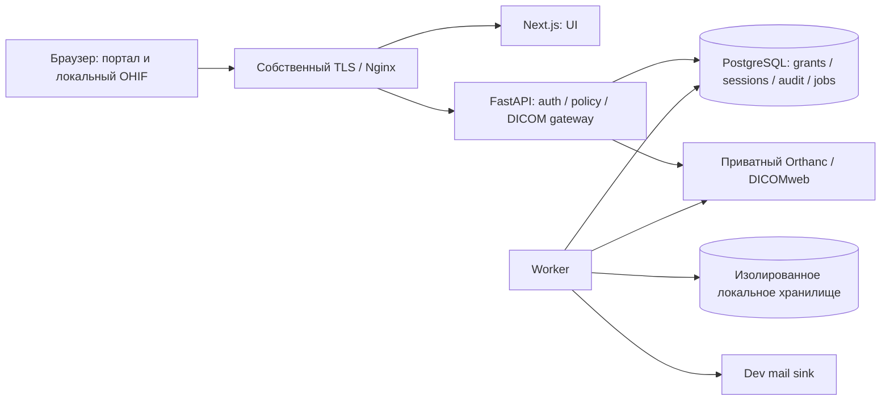
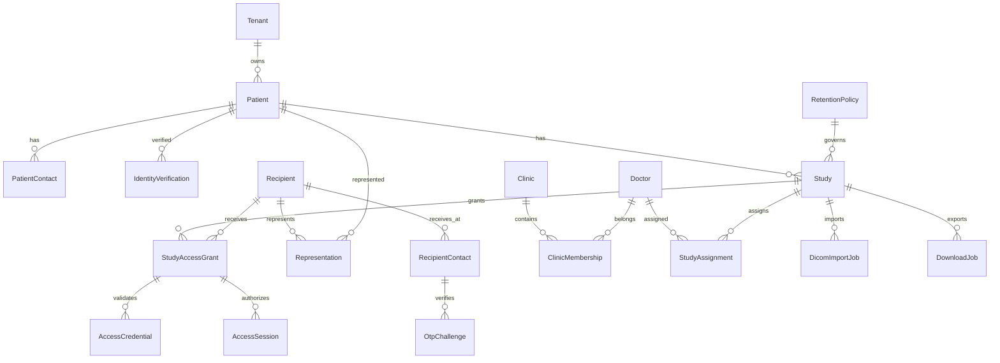

# FamilyDent Imaging — архитектура, Phase 0

Дата: 12.11.2026. Статус: предложение для проверки владельцем, не реализованная система.
Источники: ../AGENTS.md, ../CODEX_FIRST_TASK.md, TECH_SPEC.md v1.1 и ../../Медицинский-портал-FamilyDent/.

## 1. Проверенная исходная ситуация

Корень workspace содержит два соседних каталога: familydent_imaging_codex (инструкции и ТЗ) и Медицинский-портал-FamilyDent (экспорт OpenDesign). На момент аудита .git отсутствовал в обоих каталогах и корне. Нет package.json, lockfile, pyproject.toml, backend, миграций, Docker Compose, CI, тестового runner или инструкций запуска приложения. Поэтому существующего production-стека нет. Семь HTML используют общий styles.css и app.js без сборщика; это локальный прототип, не безопасное приложение. Открывать прототип с реальными данными нельзя.

В handoff: DESIGN.md, DESIGN-HANDOFF.md, DESIGN-MANIFEST.json, brand-spec.md, 7 HTML, CSS, JS, три SVG, image.png (изображение логотипа, не скриншот экрана), verification.json и critique.json. SKILL.md и локальных шрифтов нет. verification.json сообщает partial, visualCheck unavailable, responsiveCheck static-only; его pass не является результатом нашего повторного запуска. Сведения о сервере, NAS, VPS и SMTP взяты из ТЗ и не проверялись подключением.

## 2. Выбор архитектуры и альтернативы

Рекомендация: React/Next.js + TypeScript для UI, FastAPI/Pydantic для API, PostgreSQL + SQLAlchemy/Alembic для метаданных, Orthanc/DICOMweb для изображений, OHIF для просмотра, отдельный Python worker для импорта/ZIP/уведомлений. Версии и lockfiles выбрать и проверить при начале соответствующей фазы; сейчас они не закреплены и совместимость не доказана.

Альтернативы: React SPA уменьшает число runtime-сервисов, но отходит от предложенного в ТЗ Next.js; допустима после отдельного решения. Независимые микросервисы auth/grants/import требуют распределённых транзакций и усложняют отзыв, для исходных 50 исследований/день не обоснованы. Предлагаемый модульный backend держит policy и транзакции вместе, worker использует тот же доменный код. Это рекомендация автора аудита, не решение заказчика.

Next.js не принимает решений о правах и не кэширует медицинские ответы в SSR/route cache. Один origin, same-origin API. Внешняя телеметрия и CDN отключены. OHIF размещён локально; доступен только его собственный gateway datasource, без произвольных remote URL. DICOM не проходит через зарубежные image optimizer/proxy.

## 3. Предлагаемая структура монорепозитория

Корень Git = текущий workspace: так handoff сохраняется без переноса/изменений. Существующие пути остаются рабочими.

```text
AGENTS.md                            # корневые правила для обоих каталогов
README.md                            # навигация и текущие ограничения
familydent_imaging_codex/
  AGENTS.md, CODEX_FIRST_TASK.md
  docs/TECH_SPEC.md, ARCHITECTURE.md, DESIGN_MAPPING.md,
       IMPLEMENTATION_PLAN.md, DECISIONS_NEEDED.md, PHASE_0_AUDIT.md
Медицинский-портал-FamilyDent/         # неизменяемый эталон дизайна
apps/web/src/
  app/                               # отдельные публичные/patient/doctor/staff/admin маршруты
  components/                        # перенос композиции handoff
  styles/tokens.css                  # точные токены styles.css
  fixtures/                          # только явно синтетические UI fixtures
services/api/app/
  auth/, patients/, studies/, grants/, clinics/, audit/
  imaging/, downloads/, notifications/, retention/, incidents/
  policy.py                          # общая проверка разрешений
services/api/alembic/
services/worker/                      # импорт, ZIP, outbox, TTL cleanup
packages/contracts/                  # OpenAPI и сгенерированные типы
infra/local/                         # Compose, mail sink, изолированные volumes
infra/ohif/                          # конфигурация собственного datasource
tests/
  security/, integration/, e2e/, fixtures/synthetic/
```

Пути apps/services/packages/infra/tests — только план; в Phase 0 не создаются. Общие Python domain/policy принадлежат services/api, worker импортирует пакет, а не копирует правила. Сам DICOM/ZIP никогда не хранится в Git.

## 4. Сервисы, потоки и границы доверия



В production-проекте только: VPS в Таджикистане TCP passthrough → исходящий WireGuard → собственный TLS. DMZ/APP/DATA/MGMT deny-by-default; Orthanc/DB/NAS не публикуются. Все медицинские копии и backup физически в Таджикистане. SMTP Германии — отдельное юридическое решение; dev использует sink. Ни эта топология, ни внешние сервисы сейчас не развёрнуты.

API управляет состояниями, policy, transaction audit и выдачей потоков; PostgreSQL — источник прав и отзывов; Orthanc хранит DICOM и не определяет пользовательские разрешения. Worker исполняет долговечные задания с retry/idempotency, лимитами и reconciliation. Предлагается PostgreSQL job queue + transactional outbox без Redis на старте; claim задач с lease, heartbeat, bounded retry, dead-letter. Выбор механизма проверить нагрузочным spike на синтетике перед Phase 5. Внутрипроцессные post-response tasks не использовать как единственное хранилище задач импорта.

Импорт: staff → временный карантин → ограничения/magic bytes/архив/UID → Orthanc private → ручное подтверждение соответствия внутреннему пациенту → READY. Сбой между Orthanc и БД компенсируется reconciliation; частичный импорт никогда не READY. Outbox отправляет только нейтральные сообщения после commit.

## 5. Нормализованная модель и ERD

Предлагаемые внутренние id — UUID; DICOM UID отдельный уникальный ключ, не токен доступа. Tenant — организация-владелец исследования (FamilyDent); Clinic — партнёр/филиал внутри явно выбранной модели. До Phase 2 утвердить, являются ли сторонние клиники отдельными tenant или получателями внутри tenant FamilyDent. Независимо от ответа clinic membership не даёт доступа к исследованию.



Дополнение к обязательным сущностям ТЗ: Tenant, User, Recipient (пациент/представитель/doctor как получатель), RecipientContact, Representation, staff/doctor AuthSession, MfaCredential, OutboxEvent, SeriesInstanceIndex. Recipient позволяет проверяемый FK вместо небезопасной пары polymorphic recipient_type/recipient_id; CHECK/type и связь с Patient/Doctor должны быть согласованы миграцией. Email не уникален между пациентами и получателями; отдельные contact_id сохраняют владельца, историю и version. OTP до ввода карточки не должен выбирать пациента по email: challenge привязан к адресу и purpose, после карточки проверяется совпадение активного контакта конкретного recipient и его version.

Patient.local_identifier уникален в tenant, не имя/email. Study: tenant_id, patient_id, dicom_study_uid, state, retention_policy_id. Grant: tenant_id, study_id, recipient_id/type, allowed_actions, valid_from/until, status, created_by, revocation fields. FK (tenant_id, study_id) и аналогичные composite FK исключают межtenant-связи. Assignment явно связывает doctor/study/clinic context; membership имеет validity; запросы требуют обеих действующих связей, а не доверяют clinic_id из браузера.

AccessCredential хранит только HMAC/проверочный hash секрета >=128 бит, key version, issue/expiry/revocation. Сырой секрет доступен лишь при контролируемой выдаче/печати, не для повторного чтения. Session хранит hash opaque cookie, grant_id, single study_id, contact_version, idle/absolute expiry, revoked_at. OTP: keyed digest + key version, challenge purpose/binding, expires_at, attempts, consumed_at, cooldown; потребление и попытки атомарны. AuditEvent/Incident/Notification/RetentionPolicy/DownloadJob/DicomImportJob — обязательны; job содержит id, state, idempotency key, owner/tenant, lease/retry, безопасную ссылку на локальный артефакт, не секреты.

Индексы: grants(recipient_id,study_id,status), assignments(doctor_id,study_id,status), sessions(grant_id,revoked_at), jobs(state,available_at), audit(tenant_id,created_at), unique tenant+local_identifier и DICOM UID в выбранном архивном namespace. CHECK valid_until>valid_from; ограничения recipient type/action, дедупликация активных assignment; операции с grant и audit в одной транзакции. Состояние аудита append-only для app role, отдельные migration/admin credentials, контролируемая архивная копия с проверкой целостности.

## 6. Авторизация и состояния

Общий проектный интерфейс: authorize_study(context: AccessContext, study_id: UUID, action: StudyAction) -> AuthorizedStudy. Он проверяет identity/MFA контекст, tenant, active assignment или адресный grant, READY, сроки, session/contact version и отзыв. Role сама по себе не открывает медданные.

| Роль | Доступ |
|---|---|
| platform_admin | конфигурация/аккаунты; медданные только с отдельным обоснованным правом |
| imaging_staff | регистрация/import/выдача в служебном scope после MFA |
| doctor | действующее явное назначение; действующее подтверждённое membership; MFA |
| clinic_admin | состав клиники, без автоматического просмотра исследований |
| patient_recipient | fresh email OTP + физическая карточка + один grant/study |
| legal_representative | то же и действующее проверенное Representation |

Независимые оси состояний: identity PENDING_IDENTITY/VERIFIED/REVOKED; import UPLOADING/VALIDATING/QUARANTINED/AWAITING_REVIEW/READY/FAILED/BLOCKED; grant PENDING/ACTIVE/REVOKED (expiry вычисляется по серверному времени). Выдача возможна лишь при всех выполненных предусловиях. При ошибочной привязке BLOCKED и отзыв grant/session/assignment вступают атомарно до исправления; original audit сохраняется.

Пациент: нейтральный request OTP → одноразовая проверка → claim(email-proof + card secret в POST body) → короткая opaque cookie-session одного study. Предварительные числа ТЗ: 6 цифр, 5 минут, 5 попыток, idle 30 минут. Absolute TTL и глобальные лимиты ещё не согласованы. Повторная выдача карточки/смена email инвалидируют старые proofs, credentials и sessions; одно email не восстанавливает доступ. QR содержит только публичный адрес портала.

## 7. Gateway, отзыв и экспорт

Каждый API, HEAD, Range/resume, WADO/QIDO/metadata/thumbnail/bulkdata запрос проверяет policy. Для series/instance gateway разрешает UID через индекс принадлежности к разрешённому study; неизвестные UID и пути отвергаются. QIDO не проксирует глобальный список и не выдаёт чужие metadata/counts. STOW доступен только служебному импорту; у пациента/врача его нет. BulkDataURI переписывается на gateway; произвольные upstream URL запрещены (SSRF).

Проверки до отправки headers, при получении worker job и при выдаче готового ZIP. Revocation commit инвалидирует sessions и запрещает новые чанки через повторную проверку revocation version перед отправкой каждого прикладного chunk; при недоступной БД fail closed. Отдельный тест гонки и long stream обязателен: уже доставленные браузеру байты отозвать невозможно, bytes в транспортном буфере требуют измерения и утверждённой границы отзыва. Не обещать абсолютный возврат ранее скачанных данных. Не держать DB transaction на весь download; короткие проверки отдельными сессиями. Proxy buffering/cache отключены на медицинских маршрутах.

Range parser ограничивает размер/число диапазонов, проверяет нормальные/открытые/suffix ranges и возвращает корректные 206/416 без утечки existence до авторизации. Private ZIP не доступен через статический URL и не X-Accel-Redirect в обход chunk revocation. Job owner и актуальное право проверяются даже при угадывании job_id. TTL cleanup только временных файлов; originals/backups не удаляются автоматически.

## 8. Контракты и защита

API-группы из ТЗ §7 сохраняются как ориентир: staff patients/studies/imports/identity/grants/cards; patient otp/request, otp/verify, claim, study, downloads; doctor auth/studies/downloads; study viewer gateway; admin audit/incidents/retention. Для каждой операции в Phase 2 записать DTO, role/scope, preconditions, generic errors, audit event и negative tests. Error envelope: code, message, request_id; без PII/секретов и диагностических traces. Публичные request OTP ответы одинаковы для неизвестного/известного адреса; timing и rate limits проверяются отдельно. Cookie HttpOnly/Secure/SameSite, CSRF для mutations, rotation, CSP, TLS, HSTS на согласованном origin; no-store для всех медицинских ответов и отсутствие service-worker persistence.

Из приложения не логировать payload/OTP/card/cookie/credentials/identity copies. Безопасные события UTC + actor/study/grant, result, request_id; IP/UA только по утверждённой политике. SMTP текст нейтральный, общий URL, без study_id/ФИО/вложений. Передавать медидентификаторы через mailto поддержки также запрещено.

## 9. Проверка технических предпосылок и ограничения

12.11.2026 Context7: library FastAPI → /websites/fastapi_tiangolo (High), затем docs с вопросом о gateway/streaming/background jobs. Документация подтверждает поддержку Range у FileResponse и особенности времени жизни yield dependencies во время streaming: https://fastapi.tiangolo.com/reference/responses/ и https://fastapi.tiangolo.com/advanced/advanced-dependencies/ . Встроенная поддержка HTTP Range сама по себе не реализует отзыв и policy — это наш проектный вывод. Совместимость конкретных OHIF/Orthanc/Next.js версий, transfer syntaxes Romexis, MPR и diagnostic suitability пока не проверены; обязательный synthetic spike Phase 5. Инфраструктурные и юридические сведения остаются предположениями ТЗ, не утверждением готовности.
